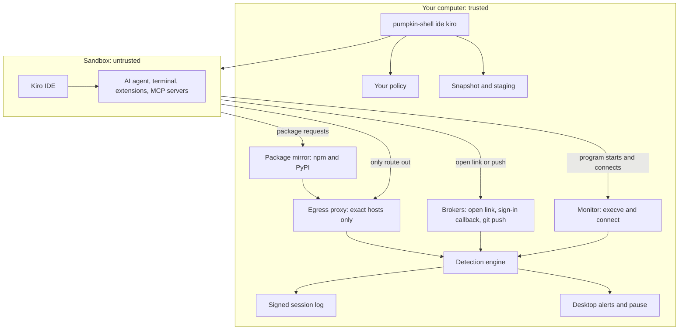
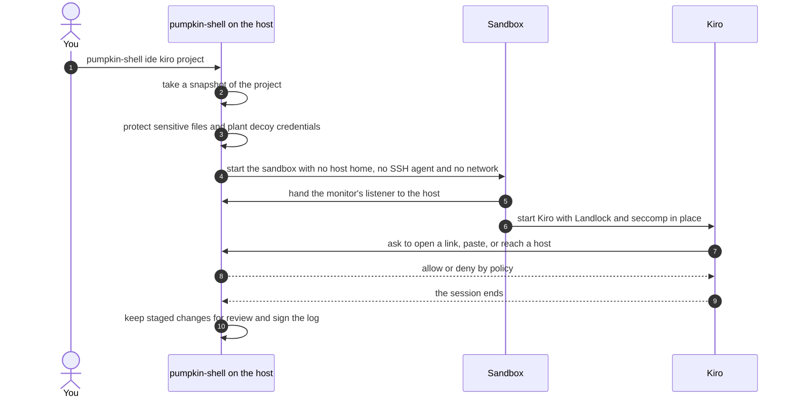
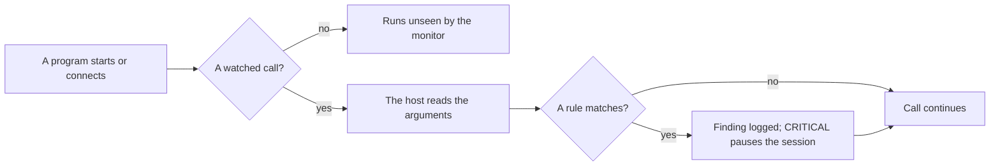
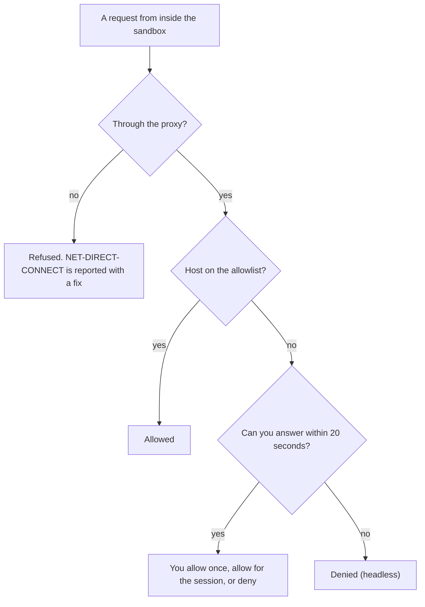
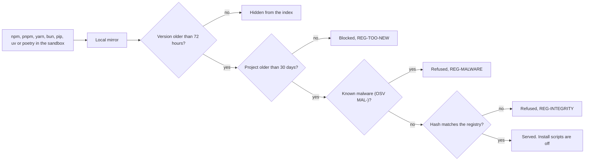

# Pumpkin-Shell

**Use an AI coding IDE in full auto-approve mode without giving it your
machine.**

Pumpkin-Shell opens your project in an IDE such as Kiro inside a sandbox. The
AI in the IDE can read and change the project, but it cannot reach your SSH
keys, cloud logins, host files outside the project, or the internet except
through a checked proxy.

Version 1.0.0 supports **Linux** and **Kiro**. Windows, VS Code, Cursor and
Windsurf come after the first release.

License: MIT (see [LICENSE](LICENSE)).

---

## What it is, in plain words

AI coding tools can run commands, install packages and edit files. Most of the
time that is what you want. Sometimes a README, a package, or a prompt
injection makes the tool do something harmful, such as:

- reading `~/.ssh` or `~/.aws` and sending the keys out,
- turning on "auto-approve" for itself by editing its settings file,
- installing a package whose install script steals tokens,
- running `terraform destroy` on your real infrastructure.

Pumpkin-Shell takes away what the tool needs to do that harm, and tells you
about what it tried.

## Who it is for

- **Solo developers and startups** who use an AI IDE with auto-approve and are
  afraid of a deleted folder or a leaked `.env` file.
- **DevOps engineers** whose IDE sits next to `kubectl`, `terraform` and
  `~/.aws`.
- **Security leads** who want a record of what the AI tried to do.

## What it does for you

| You get | In plain words |
|---|---|
| A sandbox | The IDE runs where it cannot see your home folder, SSH agent, Docker socket or D-Bus session. |
| A network gate | Only the hosts on the allowlist are reachable. Unknown hosts ask you first (for 20 seconds), and are refused when no one can answer. |
| A package guard | npm and PyPI installs go through a local mirror. New versions wait 72 hours, packages younger than 30 days are blocked, known malware is refused, and tarballs are checked against their published hashes. Install scripts are off. |
| Staged changes | Protected files (such as `.envrc`, `.vscode/`, `.git/hooks`) are not written directly. You review each change with `pumpkin-shell review`. |
| Alerts | Decoy credentials, risky commands, direct network attempts and auto-approve settings raise alerts. A CRITICAL alert pauses the session. |
| A signed log | Every decision goes into a log that is hash-chained and signed. `pumpkin-shell log verify` checks that nothing was edited. |
| Snapshots | The project is snapshotted before the IDE starts. `pumpkin-shell restore` brings it back. |

## What it does not do

- It does not make the AI's code correct.
- It does not stop you from running code it produced after you leave the
  sandbox.
- It does not protect data sent to a domain you allowed (for example the AI
  model's own API).
- It does not run on macOS, and Windows comes later.
- It is not a replacement for antivirus or an EDR product.
- Escape claims are measured, not promised. See
  [docs/ESCAPE-CORPUS.md](docs/ESCAPE-CORPUS.md): 32 of 32 attacks pass on
  corpus v1, on Linux.

---

## Install

### Requirements

| Need | Why | How to get it |
|---|---|---|
| Linux, x86_64 or ARM64, kernel 5.13 or newer (6.7 or newer recommended) | Landlock and seccomp | `uname -r` |
| `bubblewrap` 0.8 or newer | builds the sandbox | `sudo apt install bubblewrap` |
| `xserver-xephyr` and `xauth` | the IDE shows on a nested X display | `sudo apt install xserver-xephyr xauth` |
| Unprivileged user namespaces allowed | the sandbox runs without root | `pumpkin-shell doctor` tells you how to fix it |
| The IDE itself, for example Kiro | the program you protect | from [kiro.dev](https://kiro.dev/) |

Optional, for nicer alerts: `zenity` (popups), `xclip` (clipboard) and
`libnotify-bin` (desktop notifications).

The sandbox displays the IDE through X11. A Wayland desktop works only if
XWayland is running. This has not been tested yet.

### Option 1: install the Debian package (Ubuntu 24.04+, Debian 13+)

1. Download `pumpkin-shell_1.0.0_amd64.deb` from the
   [Releases page](https://github.com/mazi3012/pumpkin-shell/releases).
2. (Recommended) Check the signature, see [Verify the download](#verify-the-download).
3. Install it. `apt` also installs the dependencies:

   ```sh
   sudo apt install ./pumpkin-shell_1.0.0_amd64.deb
   ```

4. Check the machine:

   ```sh
   pumpkin-shell doctor
   ```

   Every line says PASS, WARN or FAIL. A FAIL line includes the fix to run.

### Option 2: build from source

The Rust version is pinned in `rust-toolchain.toml`. Install
[rustup](https://rustup.rs/) first, then:

```sh
git clone https://github.com/mazi3012/pumpkin-shell.git
cd pumpkin-shell
cargo build --release --locked -p pks-cli
sudo install -m 0755 target/release/pumpkin-shell /usr/local/bin/pumpkin-shell
pumpkin-shell doctor
```

### Verify the download

Each release is signed without a private key (keyless signing with
[Sigstore](https://www.sigstore.dev/)). The signature is tied to the release
workflow in this repository. Install `cosign`, then run:

```sh
cosign verify-blob \
  --bundle pumpkin-shell_1.0.0_amd64.deb.sigstore.json \
  --certificate-identity-regexp 'https://github.com/mazi3012/[Pp]umpkin-[Ss]hell/.github/workflows/release.yml@refs/tags/v.*' \
  --certificate-oidc-issuer https://token.actions.githubusercontent.com \
  pumpkin-shell_1.0.0_amd64.deb
```

Each release also has SLSA provenance, which says which workflow built the
package.

---

## Use it

Open a project in the sandboxed Kiro:

```sh
pumpkin-shell ide kiro ~/my-project
```

A window opens with Kiro. Watch the terminal you started it from: it prints
alerts, and it asks you when a site is not on the allowlist.

| Command | What it does |
|---|---|
| `pumpkin-shell doctor` | Checks that this machine can run the sandbox. |
| `pumpkin-shell scan [PATH]` | Scans a repo for setups that let an agent escape its folder. Use `--ci` in a pipeline. |
| `pumpkin-shell ide kiro [PATH]` | Opens the project in Kiro inside the sandbox. |
| `pumpkin-shell watch` | Shows findings from running sessions (WARN and above). |
| `pumpkin-shell review SESSION` | Lists staged changes, then approve or reject each one. |
| `pumpkin-shell allow-write SESSION PATH` | Approves one staged change. |
| `pumpkin-shell allow DOMAIN` | Adds a domain to the allowlist in your policy. |
| `pumpkin-shell resume SESSION` / `kill SESSION` | Continues or stops a paused session. |
| `pumpkin-shell restore SESSION` | Writes the snapshot taken before the session. |
| `pumpkin-shell trust [PATH]` | Pins the repo's `pumpkin-shell.toml` after you have read it. |
| `pumpkin-shell policy check [PATH]` | Prints the effective policy for a repo, and fails if the repo policy is not applied or tries to loosen a rule. |
| `pumpkin-shell log verify FILE` | Checks a session log's chain, signatures and checkpoint. |

Where things live:

- Your policy: `~/.config/pumpkin-shell/policy.toml`. The sandbox cannot see it.
- Sessions, snapshots and logs: `~/.local/share/pumpkin-shell/sessions/`.

---

## How it works

### The big picture



### One session, step by step



### How the monitor decides



The monitor only reports. It never blocks a call. What stops harm is that the
sandbox holds no credentials and only the proxy leads out.

### Where a network request goes



### Packages



---

## Status

| Phase | What | Status |
|---|---|---|
| 1 to 4 | Dev setup, workspace, `doctor`, `scan` | done |
| 5 to 12 | Linux sandbox, policy and log, proxy, workspace integrity, alerts and review, brokers | done |
| 14 | npm and PyPI mirror, seven clients tested through it | done |
| 15 | Exec and connect monitor | done |
| 18 | v1.0 release: corpus, signed packages, threat model | in progress |
| 6, 13, 16, 17 | Windows and other IDEs | after the first release |

The decisions and their reasons are in [docs/DECISIONS.md](docs/DECISIONS.md).
The full design is in [docs/PRD.md](docs/PRD.md). The roadmap is in
[docs/PHASES.md](docs/PHASES.md).

## Develop

```sh
cargo fmt --all -- --check
cargo clippy --all-targets --locked -- -D warnings
cargo test --locked --workspace
cargo deny check
scripts/escape-corpus.sh
```

The sandbox tests run real `bwrap`, `Xephyr` and `curl` sandboxes. Some of
them reach the public registries, so they need internet access.

## Security

Please report a vulnerability privately to the maintainer rather than in a
public issue. Contact details will be added before the release.

## License

MIT. See [LICENSE](LICENSE).
