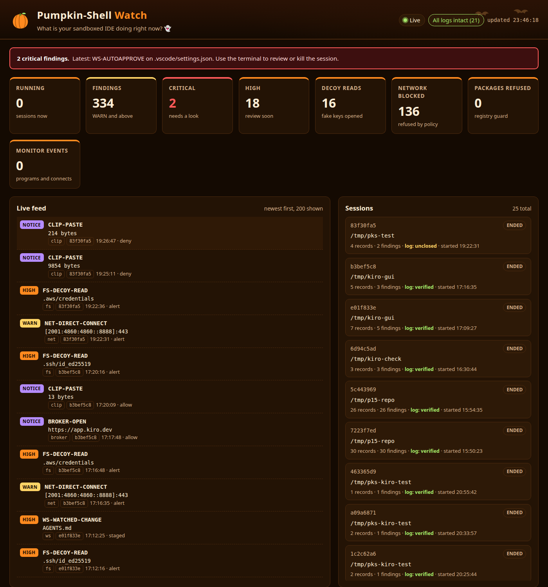
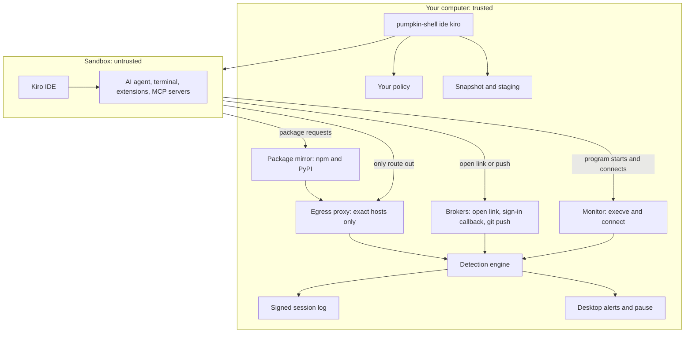
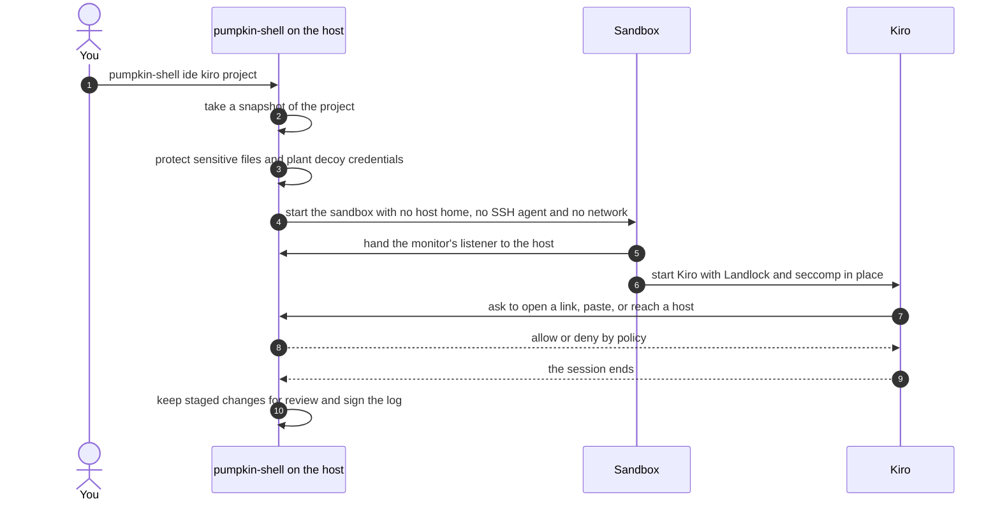
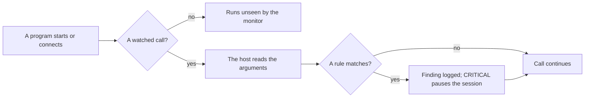
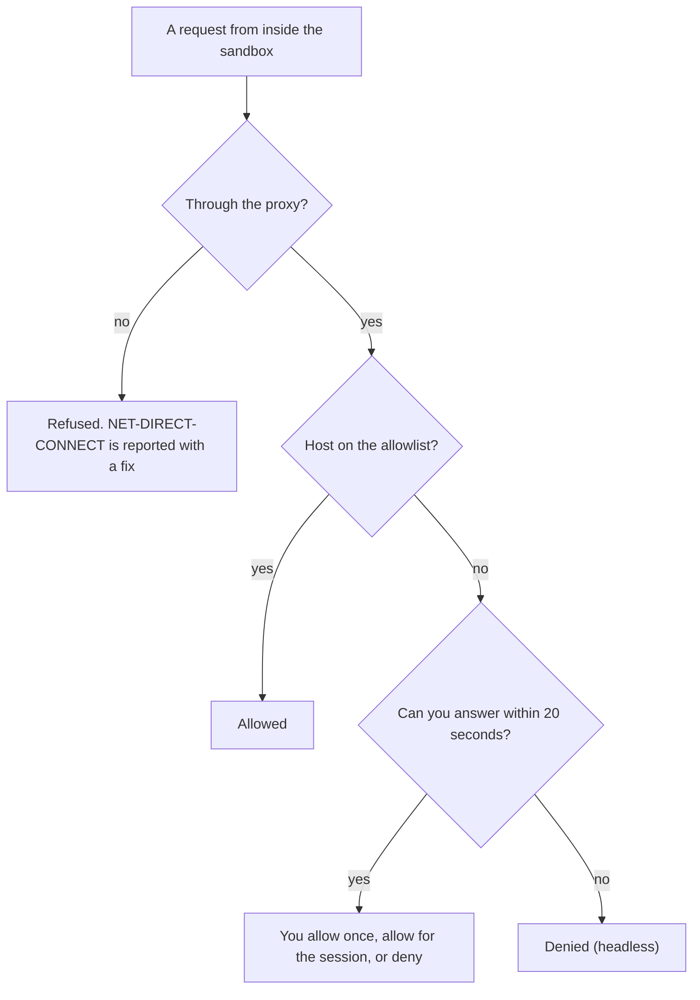
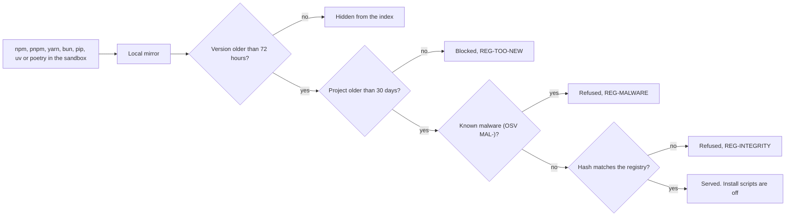

# Pumpkin-Shell

**Use an AI coding IDE in full auto-approve mode without giving it your
machine.**

Pumpkin-Shell opens your project in an IDE such as Kiro inside a sandbox. The
AI in the IDE can read and change the project, but it cannot reach your SSH
keys, cloud logins, host files outside the project, or the internet except
through a checked proxy.

Version 1.0.3 supports **Linux** and **Kiro**. Windows, VS Code, Cursor and
Windsurf come after the first release.

License: MIT (see [LICENSE](LICENSE)).

---

## What it is, in plain words

AI coding tools can run commands, install packages and edit files. Most of the
time that is what you want. Sometimes a README, a package, or a prompt
injection makes the tool do something harmful, such as:

- reading `~/.ssh` or `~/.aws` and sending the keys out,
- turning on "auto-approve" for itself by editing its settings file,
- installing a package whose install script steals tokens,
- running `terraform destroy` on your real infrastructure.

Pumpkin-Shell takes away what the tool needs to do that harm, and tells you
about what it tried.

## Who it is for

- **Solo developers and startups** who use an AI IDE with auto-approve and are
  afraid of a deleted folder or a leaked `.env` file.
- **DevOps engineers** whose IDE sits next to `kubectl`, `terraform` and
  `~/.aws`.
- **Security leads** who want a record of what the AI tried to do.

## What it does for you

| You get | In plain words |
|---|---|
| A sandbox | The IDE runs where it cannot see your home folder, SSH agent, Docker socket or D-Bus session. |
| A network gate | Only the hosts on the allowlist are reachable. Unknown hosts ask you first (for 20 seconds), and are refused when no one can answer. |
| A package guard | npm and PyPI installs go through a local mirror. New versions wait 72 hours, packages younger than 30 days are blocked, known malware is refused, and tarballs are checked against their published hashes. Install scripts are off. |
| Staged changes | Protected files (such as `.envrc`, `.vscode/`, `.git/hooks`) are not written directly. You review each change with `pumpkin-shell review`. |
| Alerts | Decoy credentials, risky commands, direct network attempts and auto-approve settings raise alerts. A CRITICAL alert pauses the session. |
| A signed log | Every decision goes into a log that is hash-chained and signed. `pumpkin-shell log verify` checks that nothing was edited. |
| Snapshots | The project is snapshotted before the IDE starts. `pumpkin-shell restore` brings it back. |

## What it does not do

- It does not make the AI's code correct.
- It does not stop you from running code it produced after you leave the
  sandbox.
- It does not protect data sent to a domain you allowed (for example the AI
  model's own API).
- It does not run on macOS, and Windows comes later.
- It is not a replacement for antivirus or an EDR product.
- Escape claims are measured, not promised. See
  [docs/ESCAPE-CORPUS.md](docs/ESCAPE-CORPUS.md): 32 of 32 attacks pass on
  corpus v1, on Linux.

---

## Install

Ubuntu 24.04, Debian or Linux Mint, on a 64-bit Intel or AMD PC. Two steps.

### Step 1: install Pumpkin-Shell

```sh
wget https://github.com/mazi3012/Pumpkin-Shell/releases/latest/download/pumpkin-shell_amd64.deb
sudo apt install ./pumpkin-shell_amd64.deb
```

`apt` also installs what Pumpkin-Shell needs: bubblewrap, Xephyr and xauth.
On Ubuntu 24.04 the package also loads its AppArmor profile when the system
requires it. Kiro is not installed by apt. Get it from
[kiro.dev](https://kiro.dev/).

### Step 2: open your project in Kiro

```sh
mkdir -p ~/my-project && git -C ~/my-project init -q && pumpkin-shell kiro ~/my-project
```

Kiro opens in the sandbox. Use your own project folder in place of
`~/my-project`:

```sh
pumpkin-shell kiro /yourfolderhere
```

Pumpkin-Shell opens only the folder you give. Inside Kiro, the Open Folder
dialog cannot browse to other folders, so to work on another project, quit Kiro
and run the command again with that folder. To pick the folder in a window
instead, run `pumpkin-shell kiro` with no folder (this needs zenity, which the
package installs).

Kiro's own sign-in and service hosts are allowed by default, so no policy file
is needed. Other sites ask you first.

If something fails, run `pumpkin-shell doctor`. Each FAIL line prints the fix.

The sandbox shows Kiro through X11. Wayland works only through XWayland, which
has not been tested.

### Advanced

**Check the download (optional).** Each release is signed with Sigstore. Install
[cosign](https://github.com/sigstore/cosign/releases), then run:

```sh
wget https://github.com/mazi3012/Pumpkin-Shell/releases/latest/download/pumpkin-shell_amd64.deb.sigstore.json
cosign verify-blob --bundle pumpkin-shell_amd64.deb.sigstore.json \
  --certificate-identity-regexp 'https://github.com/mazi3012/[Pp]umpkin-[Ss]hell/.github/workflows/release.yml@refs/tags/v.*' \
  --certificate-oidc-issuer https://token.actions.githubusercontent.com \
  pumpkin-shell_amd64.deb
```

**Build from source instead of the package.** This builds the `main` branch
and installs `pumpkin-shell` to `/usr/local/bin`. Then go to Step 2.

```sh
(
set -e

# 1. Check the system: Ubuntu 24.04, Debian or Linux Mint on x86_64.
[ "$(uname -m)" = "x86_64" ] || { echo "Pumpkin-Shell needs an x86_64 machine." >&2; exit 1; }
command -v apt-get >/dev/null || { echo "This needs apt (Ubuntu, Debian or Linux Mint)." >&2; exit 1; }

# 2. System packages. Install only the ones that are missing.
PKGS="bubblewrap xserver-xephyr xauth zenity xclip libnotify-bin git build-essential curl ca-certificates"
MISSING=""
for p in $PKGS; do dpkg -s "$p" >/dev/null 2>&1 || MISSING="$MISSING $p"; done
if [ -n "$MISSING" ]; then
  echo "Installing system packages:$MISSING"
  sudo apt-get update
  sudo apt-get install -y $MISSING
else
  echo "System packages: already installed"
fi

# 3. Kiro is not installed by apt. Check for it; cell 2 needs it.
if command -v kiro >/dev/null 2>&1; then
  echo "Kiro: found"
else
  echo "Kiro: NOT FOUND. Install it from https://kiro.dev/ before running cell 2."
fi

# 4. Rust. Install rustup only when cargo is missing. The repo pins its Rust version.
export PATH="$HOME/.cargo/bin:$PATH"
if ! command -v cargo >/dev/null 2>&1; then
  echo "Installing Rust with rustup"
  tmp=$(mktemp -d)
  base=https://static.rust-lang.org/rustup/dist/x86_64-unknown-linux-gnu
  curl -fsSL -o "$tmp/rustup-init" "$base/rustup-init"
  curl -fsSL -o "$tmp/rustup-init.sha256" "$base/rustup-init.sha256"
  (cd "$tmp" && sha256sum -c rustup-init.sha256)
  chmod +x "$tmp/rustup-init"
  "$tmp/rustup-init" -y --profile minimal
  rm -rf "$tmp"
fi

# 5. Get the Pumpkin-Shell source, or update it if it is already there.
REPO="$HOME/pumpkin-shell"
if [ -d "$REPO/.git" ]; then
  git -C "$REPO" pull --ff-only
else
  git clone https://github.com/mazi3012/pumpkin-shell.git "$REPO"
fi

# 6. Build and install the pumpkin-shell command.
cd "$REPO"
cargo build --release --locked -p pks-cli
sudo install -m 0755 target/release/pumpkin-shell /usr/local/bin/pumpkin-shell
pumpkin-shell --version

# 7. Check the machine. A FAIL line prints the fix to run.
pumpkin-shell doctor || echo "doctor reported a FAIL. Apply the fix it printed, then run cell 2 again."
echo "Pumpkin-Shell is installed. Run cell 2 to launch Kiro."
)
```

The release notes and the escape corpus are in
[docs/ESCAPE-CORPUS.md](docs/ESCAPE-CORPUS.md) and
[docs/THREAT-MODEL.md](docs/THREAT-MODEL.md).

---

## Use it

Open a project in the sandboxed Kiro:

```sh
pumpkin-shell kiro /yourfolderhere
```

Without a folder, a window asks for one. (`pumpkin-shell ide kiro /yourfolderhere` does the same.) VS Code, Cursor and
Windsurf are after the first release.

A window opens with Kiro. Watch the terminal you started it from: it prints
alerts, and it asks you when a site is not on the allowlist.

| Command | What it does |
|---|---|
| `pumpkin-shell doctor` | Checks that this machine can run the sandbox. |
| `pumpkin-shell scan [PATH]` | Scans a repo for setups that let an agent escape its folder. Use `--ci` in a pipeline. |
| `pumpkin-shell kiro [PATH]` | Opens the project folder in Kiro inside the sandbox. Without a folder, a window asks for one. Same as `ide kiro`. |
| `pumpkin-shell ide kiro [PATH]` | The same, with the IDE name spelled out. Without a folder, a window asks for one. |
| `pumpkin-shell watch` | Shows findings from running sessions (WARN and above). |
| `pumpkin-shell review SESSION` | Lists staged changes, then approve or reject each one. |
| `pumpkin-shell allow-write SESSION PATH` | Approves one staged change. |
| `pumpkin-shell allow DOMAIN` | Adds a domain to the allowlist in your policy. |
| `pumpkin-shell resume SESSION` / `kill SESSION` | Continues or stops a paused session. |
| `pumpkin-shell restore SESSION` | Writes the snapshot taken before the session. |
| `pumpkin-shell trust [PATH]` | Pins the repo's `pumpkin-shell.toml` after you have read it. |
| `pumpkin-shell policy check [PATH]` | Prints the effective policy for a repo, and fails if the repo policy is not applied or tries to loosen a rule. |
| `pumpkin-shell log verify FILE` | Checks a session log's chain, signatures and checkpoint. |
| `pumpkin-shell dashboard [--port N]` | Live read-only page on 127.0.0.1 (default 8765). |

Where things live:

- Your policy: `~/.config/pumpkin-shell/policy.toml`. The sandbox cannot see it.
- Sessions, snapshots and logs: `~/.local/share/pumpkin-shell/sessions/`.

---

## Live dashboard

```sh
pumpkin-shell dashboard          # then open http://127.0.0.1:8765/
```

Pumpkin-Shell Watch shows sessions, findings by severity, network blocks,
decoy reads, refused packages and each log's check, and refreshes every two
seconds. It listens on 127.0.0.1 only, is read-only, and loads nothing from the
internet. A tampered log is shown as failed.



## How it works

### The big picture



### One session, step by step



### How the monitor decides



The monitor only reports. It never blocks a call. What stops harm is that the
sandbox holds no credentials and only the proxy leads out.

### Where a network request goes



### Packages



---

## Status

| Phase | What | Status |
|---|---|---|
| 1 to 4 | Dev setup, workspace, `doctor`, `scan` | done |
| 5 to 12 | Linux sandbox, policy and log, proxy, workspace integrity, alerts and review, brokers | done |
| 14 | npm and PyPI mirror, seven clients tested through it | done |
| 15 | Exec and connect monitor | done |
| 18 | v1.0 release: corpus, signed packages, threat model | done (v1.0.0, patch 1.0.3) |
| 19 | Live local dashboard (Pumpkin-Shell Watch) | done |
| 6, 13, 16, 17 | Windows and other IDEs | after the first release |

The decisions and their reasons are in [docs/DECISIONS.md](docs/DECISIONS.md).
The full design is in [docs/PRD.md](docs/PRD.md). The roadmap is in
[docs/PHASES.md](docs/PHASES.md).

## Develop

```sh
cargo fmt --all -- --check
cargo clippy --all-targets --locked -- -D warnings
cargo test --locked --workspace
cargo deny check
scripts/escape-corpus.sh
```

The sandbox tests run real `bwrap`, `Xephyr` and `curl` sandboxes. Some of
them reach the public registries, so they need internet access.

## Security

Please report a vulnerability privately to the maintainer rather than in a
public issue. Contact details will be added before the release.

## License

MIT. See [LICENSE](LICENSE).
